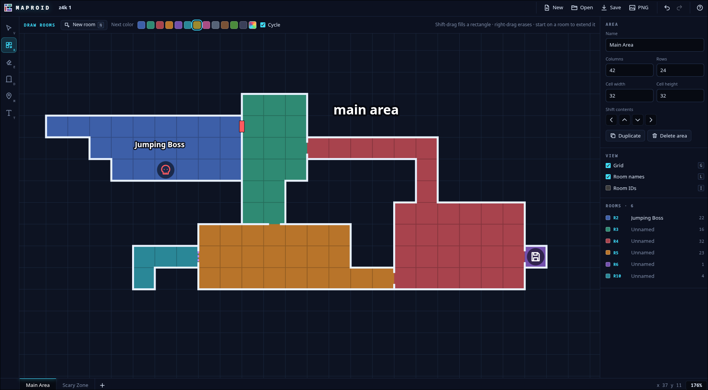

# MAPROID

Maproid is a web-based tool for creating maps for metroidvania games.

- Define your grid size, draw the grid aligned rooms easily, define doors between rooms.
- Name rooms, color rooms independently.
- Place text labels and markers on your map
- Save and load your designs with a stable json format
- Runs in a single HTML file with no dependencies.



## Using it

Use Maproid online for free here: [https://phybros.github.io/maproid/](https://phybros.github.io/maproid/). Latest commits to main get deployed here automatically.

Open `dist/index.html` in a browser, or upload that one file to any static host.

- **Draw rooms (R)**: paint cells. A cell next to the active room joins it. A cell anywhere else starts a new room. Press **N** (or "New room") to make the next stroke start a new room even next to an existing one. Shift-drag fills a rectangle. Start a stroke inside a room to keep extending it.
- **Erase (E)**: erasing a cell so a room breaks into pieces splits it into separate rooms, each with its own ID.
- **Doors (D)**: click any wall edge. The types are opening, door, red, green and yellow locks, and secret.
- **Markers (M)**: save points, bosses, items, keys, warps and more, one per cell.
- **Text (T)**: free-floating labels.
- **Select (V)**: select and drag rooms, markers and labels. Name and colour rooms and add notes in the inspector.
- **Areas**: tabs along the bottom. Each area has its own grid size and cell dimensions.

Work autosaves to the browser's localStorage. **Save** downloads a `.maproid.json` file. **Open** (or drag-and-drop) loads one. **PNG** exports the current area. Press `?` in the app for all keyboard shortcuts.

## Development

```sh
npm install
npm run dev     # local dev server
npm test        # unit tests (vitest)
npm run build   # type-check and bundle everything into dist/index.html
```

The source is TypeScript with no runtime dependencies. Vite and `vite-plugin-singlefile` inline all JS and CSS into the single output HTML file.

- `src/model.ts`: data model and pure map operations (adjacency, room splitting, moving, validation)
- `src/store.ts`: app state, undo/redo history and autosave
- `src/render.ts`: canvas renderer, shared by the editor and PNG export
- `src/editor.ts`: canvas view, pan/zoom and tool interactions
- `src/ui.ts`: toolbar, inspector, area tabs, dialogs and keyboard shortcuts
